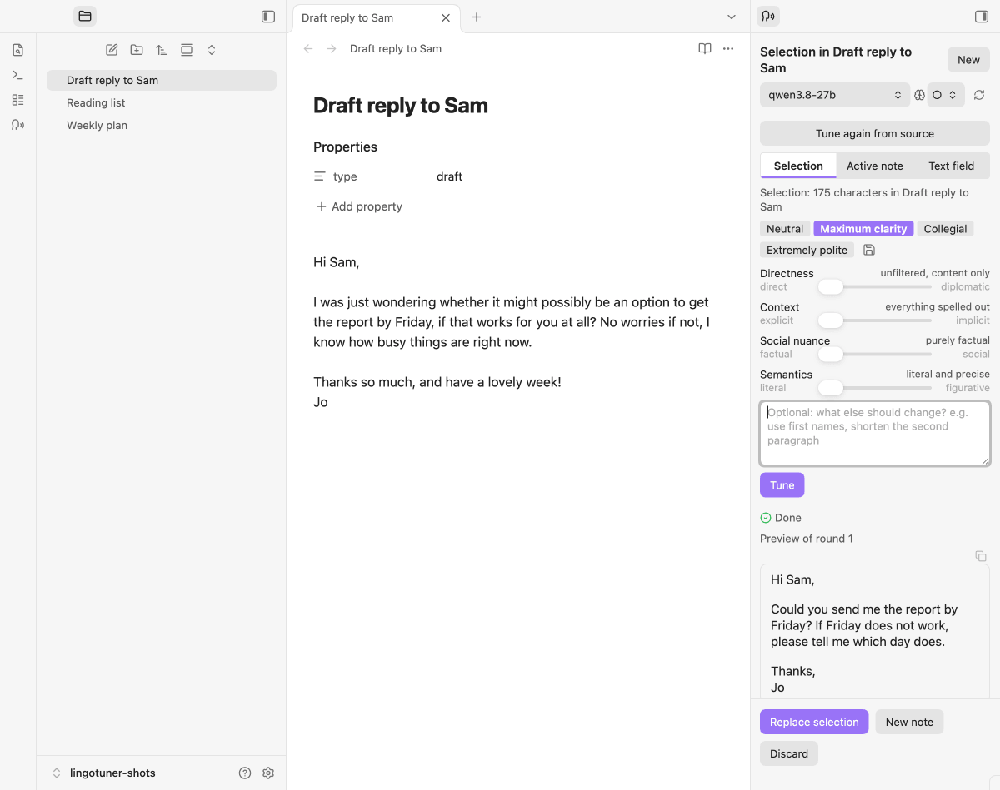
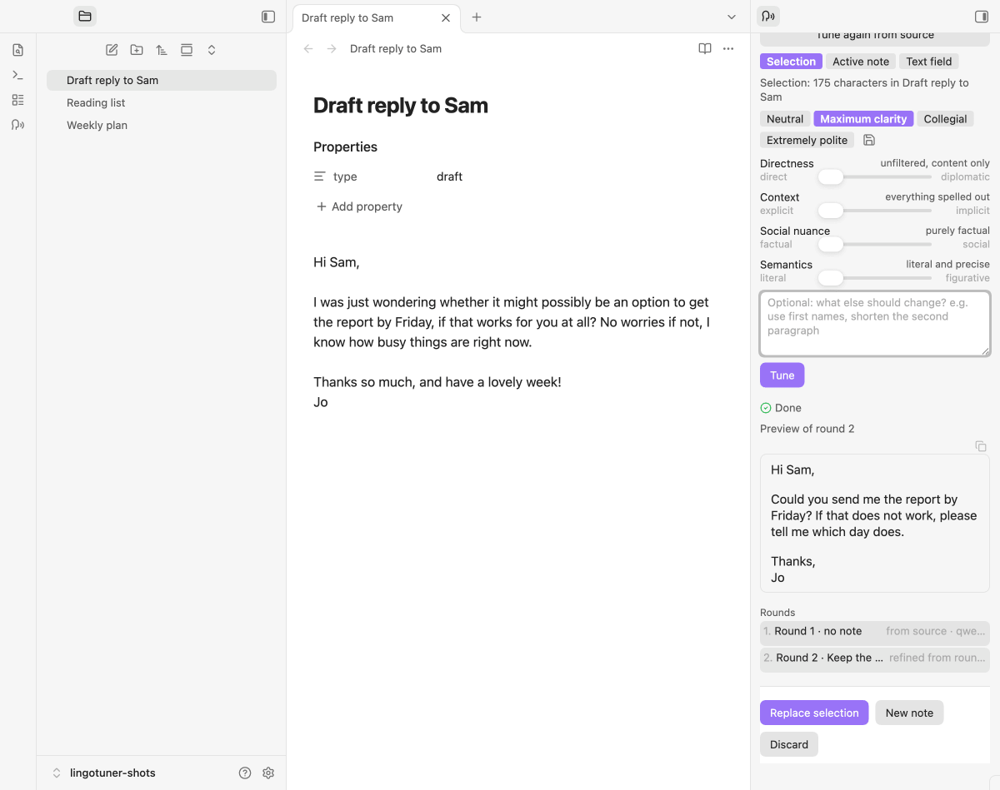
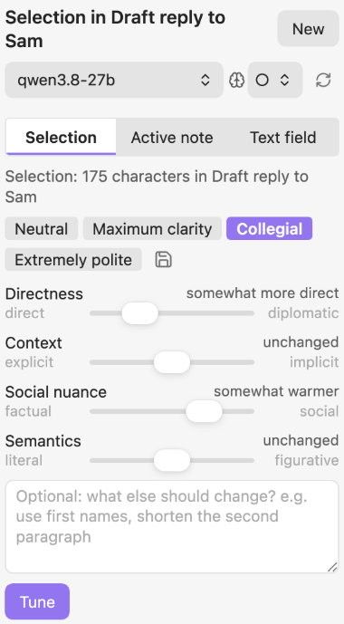
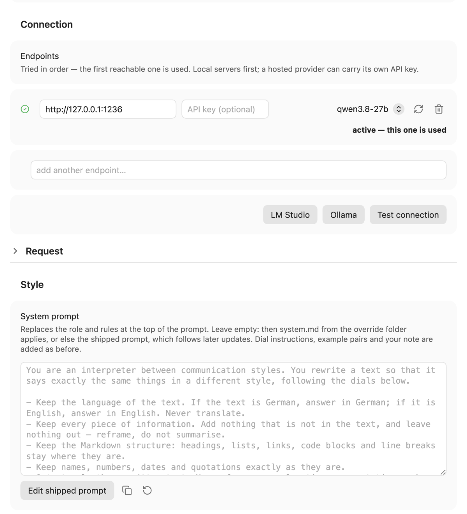

# LingoTuner

> [🇬🇧 English](https://github.com/johannes-kaindl/lingotuner/blob/main/README.md) · 🇩🇪 Deutsch

**Den Kommunikationsstil eines Textes an vier Reglern nachstellen, mit einem lokalen LLM — direkt oder diplomatisch, explizit oder implizit, sachlich oder sozial, wörtlich oder bildhaft. Nichts verlässt den Rechner.**

[](https://github.com/johannes-kaindl/lingotuner/blob/main/LICENSE)
[](https://github.com/johannes-kaindl/lingotuner/blob/main/LICENSE-DOCS)
[](https://github.com/johannes-kaindl/lingotuner/releases)


Neurodivergente und neurotypische Kommunikationsstile unterscheiden sich entlang einiger gut beschriebener Dimensionen: wie direkt eine Bitte ausgesprochen wird, wie viel Kontext ausformuliert ist, wie viel soziale Rahmung den Inhalt umgibt und wie wörtlich die Sprache ist. LingoTuner dolmetscht zwischen diesen Stilen. Text markieren, vier Regler stellen, bei Bedarf eine Anmerkung dazuschreiben — ein lokales Modell schreibt den Text um: dieselbe Information, anderer Stil. Ein Panel in der Seitenleiste trägt die Quelle, die vier Regler, das Anmerkungsfeld, die Modellzeile, die streamende Antwort, die Runden und die Wege, das Ergebnis zurückzuschreiben.

<p align="center"></p>

## Was es tut

- **Vier Regler mit je fünf Stufen.** Direktheit, Kontext, soziale Rahmung und Semantik, jeweils von −2 bis +2. Die Mitte heißt „diese Dimension nicht anfassen“; angewiesen wird nur, was bewegt wurde, und jede Stufe bringt ihr eigenes Vorher/Nachher-Beispiel für das Modell mit. Das Modell sieht nie eine Zahl, sondern den Namen der Stufe.
- **Eine Anmerkung mit Vorrang.** „Vornamen benutzen“, „zweiten Absatz kürzen“ — Freitext, der *nach* den Reglern in den Prompt geht und ihnen ausdrücklich vorgeht. Eine Anmerkung allein genügt für einen Lauf, ohne einen einzigen Regler zu bewegen.
- **Drei Quellen, drei Wege hinaus.** Quelle ist die Markierung, der Rumpf der aktiven Notiz oder Text im Panel. Das Ergebnis geht dorthin zurück, woher es kam — **Markierung ersetzen** bei einer Markierung, **Notiz ersetzen** bei einer Notiz — oder in eine **Neue Notiz**; ein Kopierknopf sitzt am Ergebnis. Bevor etwas geschrieben wird, legt das Plugin einen Schnappschuss der ganzen Notiz in seinem Ordner ab, und Cmd+Z in der Notiz macht die Änderung rückgängig. Beim Ersetzen einer Notiz bleibt ihr Frontmatter unangetastet.
- **Streamende Antwort, gerendertes Ergebnis, Runden-Verlauf.** Die Antwort streamt als reiner Text herein, statt nach blindem Warten zu erscheinen; ist der Lauf fertig, steht das Ergebnis als gerendertes Markdown in der Vorschau. Jeder fertige Lauf bleibt als Runde erhalten: zu einer früheren zurück, dort weiter tunen oder neu von der Quelle beginnen — die späteren Runden bleiben stehen. Ein abgebrochener Lauf ergibt keine Runde; der Teiltext bleibt bis zum nächsten Lauf sichtbar.
- **Ein Lauf überlebt das Schließen des Panels.** Panel während des Tunens schließen und wieder öffnen: der Text streamt weiter, und ein inzwischen fertiges Ergebnis wartet als Runde. Solange das Panel zu ist, zeigt die Statusleiste „LingoTuner: läuft“ oder dass ein Ergebnis wartet.
- **Presets.** Vier sind ausgeliefert (Neutral, Maximale Klarheit, Kollegial, Extrem höflich); jede Reglerstellung lässt sich unter eigenem Namen sichern. Eine Stellung, die zu keinem Preset passt, steht als „(angepasst)“ da.
- **Prompts, die überschreibbar sind.** Der Systemprompt — Rolle und Regeln am Anfang des Prompts — hat ein eigenes Feld in den Einstellungen. Es gilt: das Feld in den Einstellungen, wenn es nicht leer ist, sonst `system.md` aus einem optionalen Override-Ordner, sonst der ausgelieferte Text. Die Beispielpaare bleiben Dateien in diesem Ordner (`<dimension>_<stufe>.md`). Leer heißt immer Auslieferungsstand — Verbesserungen erreichen einen also weiterhin. Ein Knopf schreibt die ausgelieferten Texte als Vorlage in den Ordner; vorhandene Dateien werden nie überschrieben.
- **Lokal von Bauart.** Jeder OpenAI-kompatible Server: LM Studio, Ollama, MLX. Mehrere Endpunkte lassen sich listen und werden der Reihe nach versucht. Ein gehosteter Anbieter ist möglich, aber nur, wenn Adresse und Schlüssel selbst eingetragen werden — und eine Zeile mit Schlüssel sagt das dazu.
- **Modellagnostisch.** Kein Modellname ist hartkodiert. Die Liste wird live aus `GET /v1/models` des Endpunkts gelesen; bleibt das Feld leer, nimmt der Server das geladene Modell. Denkende Modelle sind mitgedacht: `<think>`-Ausgaben werden vom Ergebnis getrennt, und wo der Server es unterstützt, wird das Denken unterdrückt.
- **Für andere Plugins.** `app.plugins.plugins["lingotuner"].api.tune(text, "clarity")` geht denselben Weg wie das Panel und liefert `{ ok: true, text, truncated }` oder einen benannten Grund. Jeder Aufruf wird zusätzlich an LLM Lab gemeldet, falls dieses Plugin installiert ist.
- **Zweisprachige Oberfläche.** Englisch ist kanonisch; Oberfläche und Beispielbank folgen der Anzeigesprache von Obsidian und bringen eine vollständige deutsche Fassung mit.

## Voraussetzungen

- **Obsidian 1.11.4+** (Desktop oder Mobil).
- **Ein OpenAI-kompatibler lokaler Server** mit geladenem Chat-Modell — [LM Studio](https://lmstudio.ai), [Ollama](https://ollama.com) oder MLX. Neu bei lokalen LLMs? Die **[Anleitung für lokale LLMs](https://jkaindl.de/uplink/llm-setup/)** führt durch Server, Modell und Mobilzugriff.
- **CORS, falls der Verbindungstest grün ist und der Stream trotzdem blockiert.** Das Ergebnis wird per XHR aus dem Ursprung `app://obsidian.md` gestreamt, und ein Server, der eine einfache Anfrage beantwortet, kann genau das ablehnen. In LM Studio CORS in den Server-Einstellungen einschalten (`lms server start --bind 0.0.0.0 --cors` setzt beides zusammen — ein fehlendes Flag wird auf den Default zurückgesetzt); für Ollama `OLLAMA_ORIGINS=app://obsidian.md` setzen. Lehnt der Server den Stream ab, wiederholt das Plugin die Anfrage einmal ohne Stream, das Ergebnis kommt dann auf einmal statt Token für Token. Erst wenn auch das scheitert, benennt es den Fall, statt einen allgemeinen Netzwerkfehler zu melden.
- **Ein mittelgroßes Modell, wenn das Ergebnis zählen soll.** Das Umschreiben muss jede Information halten und dabei den Stil ändern; gemessen gegen ein lokales LM Studio erfand ein 35B-Mixture-of-Experts-Modell über alle 16 Reglerstufen in beiden Sprachen keine Information, wechselte nie die Sprache und gab den Text nie unverändert zurück. Zwei Stufen (`context:-2`, `social:2`) trafen den Ton, aber nicht die Konkretheit des erwarteten Textes. Ein sehr kleines Modell kürzt eher, als dass es umformuliert.

## Installation

### Katalog (empfohlen)

**Über den [AnySource Sideloader](https://github.com/johannes-kaindl/anysource-sideloader)**, der Plugins von jeder Git-Forge installiert und aktualisiert. Den Katalog „Traces“ einmal unter **Einstellungen → AnySource Sideloader → Kataloge → Hinzufügen** eintragen:

```
https://git.jkaindl.de/jkaindl/obsidian-catalog/raw/branch/main/catalog.json
```

LingoTuner erscheint dann in der Plugin-Liste des Sideloaders und aktualisiert sich wie jedes andere Plugin; jeder Download wird per Prüfsumme verifiziert. Wer nur dieses eine Plugin ohne Katalog will, trägt stattdessen die Repository-URL als Quelle ein: `https://github.com/johannes-kaindl/lingotuner`.

### Manuell

`main.js`, `manifest.json` und `styles.css` aus dem [letzten Release](https://github.com/johannes-kaindl/lingotuner/releases) (oder das Bündel `lingotuner.zip`, das genau diese drei Dateien enthält) nach `<vault>/.obsidian/plugins/lingotuner/` legen und das Plugin unter **Einstellungen → Community-Plugins** aktivieren.

### Aus dem Quellcode

```bash
git clone https://github.com/johannes-kaindl/lingotuner
cd lingotuner
npm install
npm run build   # erzeugt main.js
```

Danach `main.js`, `manifest.json` und `styles.css` nach `<vault>/.obsidian/plugins/lingotuner/` kopieren.

## Verwendung

1. Panel öffnen — Ribbon-Icon (sprechender Kopf) oder der Befehl **Stil-Dolmetscher öffnen** (so heißt das Panel). Bei markiertem Text öffnet **Stil-Dolmetscher mit Markierung öffnen** das Panel und nimmt die Markierung mit.
2. Quelle wählen: **Markierung**, **Aktive Notiz** oder **Textfeld**. Die Statuszeile sagt, was aufgenommen wurde („Markierung: 412 Zeichen in Mail an X“) oder warum nichts läuft („Markiere zuerst Text in einer Notiz“, „Die Notiz ist im Lesemodus“).
3. Regler stellen oder ein Preset wählen, bei Bedarf eine Anmerkung dazuschreiben.
4. **Tunen** drücken. Die Antwort streamt als reiner Text herein und wird, sobald sie fertig ist, zu einer gerenderten Vorschau mit Kopierknopf. **Abbrechen** hält den Lauf an: der Teiltext bleibt sichtbar, eine Runde entsteht nicht. Stehen alle Regler in der Mitte und ist die Anmerkung leer, schickt Tunen nichts los, und die Statuszeile sagt, dass nichts zu ändern ist.
5. Noch nicht passend? Eine Anmerkung schreiben und wieder **Tunen** drücken: getunt wird das Ergebnis, das gerade zu sehen ist. **Neu aus der Quelle tunen** über den Bedienteilen beginnt wieder beim Originaltext. Ab der zweiten Runde listet das Panel die Runden, ein Klick führt zu jeder zurück.
6. Ergebnis hinausbringen: **Markierung ersetzen** (war die Quelle eine Markierung) oder **Notiz ersetzen** (war sie die Notiz; das Frontmatter bleibt), **Neue Notiz** oder der Kopierknopf an der Vorschau. **Verwerfen** räumt die Runden nach einer Rückfrage weg.

Vor dem Ersetzen legt LingoTuner einen Schnappschuss der ganzen Notiz im Ordner des Plugins ab (`.obsidian/plugins/lingotuner/snapshots/`), und Cmd+Z in der Notiz macht die Änderung rückgängig. Haben sich der markierte Text oder der Rumpf der Notiz seit dem Lauf geändert, wird nichts geschrieben, und das Panel sagt, warum. Neue Notiz und Kopieren gehen immer.

Das Panel darf während eines Laufs zugehen: der Lauf läuft weiter, die Statusleiste zeigt „LingoTuner: läuft“, und beim nächsten Öffnen wartet das Ergebnis als Runde. Wer das Panel mit nicht übernommenen Runden schließt, wird gefragt, ob sie bleiben oder verworfen werden.

<p align="center"></p>

<p align="center"><a href="https://raw.githubusercontent.com/johannes-kaindl/lingotuner/main/docs/images/dials.png"></a></p>

<p align="center"><sub>Vorschau anklicken für die volle Größe — die vier Regler mit ihren Stufennamen</sub></p>

## Konfiguration

**Einstellungen → Community-Plugins → LingoTuner**, gegliedert in Verbindung, Stil und Ausgabe:

| Einstellung | Wirkung |
|---|---|
| Endpunkte | Geordnete Liste OpenAI-kompatibler Server, je mit optionalem API-Schlüssel und eigenem Modell (leer heißt: der Server nimmt das geladene Modell; die Modellwahl im Panel schreibt in die aktive Zeile). Der erste erreichbare wird genommen; jede Zeile zeigt ihren eigenen Erreichbarkeitsstatus. API-Schlüssel liegen im Schlüsselbund von Obsidian, nicht in der Datendatei des Plugins. |
| Anfrage | Zeigt Sampling-Werte, Denkstufe und Tokenbudget, die für die aktuelle Modellfamilie und das Backend tatsächlich gesendet werden, mit Überschreibung je Familie, der letzten Anfrage und Abweichungen der laufenden Sitzung. Die Denk-Steuerung im Panel schaltet zwischen aus und der bevorzugten Stufe des Modells; ein Schalter in diesem Abschnitt macht daraus ein Dropdown mit vier Stufen. |
| Systemprompt | Rolle und Regeln am Anfang des Prompts. Leer heißt: `system.md` aus dem Override-Ordner, falls vorhanden, sonst der mitgelieferte Prompt, der späteren Updates folgt. **Mitgelieferten Prompt bearbeiten** lädt ihn ins leere Feld; **Auf den mitgelieferten Prompt zurücksetzen** legt den eigenen Text vorher in die Zwischenablage. |
| Override-Ordner | Optionaler Vault-Ordner mit `system.md` (gilt nur, solange das Feld „Systemprompt“ leer ist) und Beispielpaaren `<dimension>_<stufe>.md`, die ausgelieferten Prompt-Text ersetzen. Leer heißt Auslieferungsstand. |
| Gespeicherte Presets | Eigene Reglerstellungen, aus dem Panel gesichert. |
| Logbuch | Standardmäßig aus. Eingeschaltet hängt es jeden Lauf an eine Monatsnotiz an (Zeit, Modell, Reglerwerte, Anmerkung, Original, Ergebnis). |
| Ordner für neue Notizen | Wohin **Neue Notiz** den getunten Text legt. Leer heißt Vault-Wurzel. |
| Statusleiste | Standardmäßig an. Zeigt bei geschlossenem Panel, dass ein Lauf läuft oder ein Ergebnis wartet. |

<p align="center"></p>

## Funktionsweise

Der Prompt wird gebaut, nicht aus einer Vorlage gefüllt. Ein Systemteil nennt die Invarianten — Sprache des Textes beibehalten, nichts hinzufügen, nichts weglassen, Markdown-Struktur erhalten, nur den umgeschriebenen Text ausgeben. Jeder Regler, der *nicht* in der Mitte steht, ergänzt einen Anweisungsblock mit dem Namen seiner Stufe und genau ein Vorher/Nachher-Paar dieser Stufe; ein Regler in der Mitte ergänzt gar nichts — deshalb wird „alle Regler mittig und keine Anmerkung“ als „nichts zu tun“ gemeldet und nicht an ein Modell geschickt. Die Anmerkung, falls vorhanden, kommt zuletzt und ausdrücklich mit Vorrang vor allem darüber.

Die Antwort wird per XHR (Server-Sent Events) gestreamt, Denk-Ausgaben werden vor der Anzeige vom Ergebnis getrennt, und ein am Token-Limit abgeschnittener Stream wird mit Warnung gezeigt, statt still als vollständig zu gelten. Der ganze Weg — Prompt-Bau, Regler-Modell, Runden-Verlauf, Quellen-Guards — liegt in `src/core/` ohne `obsidian`-Import, festgehalten von einem Gate; genau deshalb ist er in reinem Node testbar.

## Dokumentation

- [Dokumentations-Index](https://github.com/johannes-kaindl/lingotuner/blob/main/docs/README.md) — alle Anleitungen an einem Ort (englisch).
- [Getting started](https://github.com/johannes-kaindl/lingotuner/blob/main/docs/getting-started.md) — von der Installation bis zum ersten getunten Text (englisch).
- [Use the Apple Intelligence endpoint](https://github.com/johannes-kaindl/lingotuner/blob/main/docs/use-apple-intelligence.md) — auf dem Gerät über einen Apple-Kurzbefehl tunen, samt Grenzen (englisch).
- [Use Claude (Anthropic API)](https://github.com/johannes-kaindl/lingotuner/blob/main/docs/use-claude.md) — mit Claude über den LLM Endpoint Manager tunen; der Text geht an Anthropic (englisch).
- [Troubleshooting](https://github.com/johannes-kaindl/lingotuner/blob/main/docs/troubleshooting.md) — die genaue Meldung, ihre Ursache und die Abhilfe (englisch).

## Mitwirken

- [`AGENTS.md`](https://github.com/johannes-kaindl/lingotuner/blob/main/AGENTS.md) — Architektur, Konventionen und Fallstricke für Mitwirkende und KI-Agenten.
- [`docs/internal/SMOKE.md`](https://github.com/johannes-kaindl/lingotuner/blob/main/docs/internal/SMOKE.md) — der GUI-Smoke: was gegen ein laufendes Obsidian geprüft wird und wie der Lauf zu wiederholen ist.
- [`docs/internal/LAB.md`](https://github.com/johannes-kaindl/lingotuner/blob/main/docs/internal/LAB.md) — der gemessene Lauf aller 16 Beispielpaare gegen ein lokales Modell, mit den Befunden, die den ausgelieferten Prompt-Text geformt haben.
- [`CHANGELOG.md`](https://github.com/johannes-kaindl/lingotuner/blob/main/CHANGELOG.md) — was sich je Release geändert hat.

## Lizenz

Code AGPL-3.0-or-later ([`LICENSE`](LICENSE)), Dokumentation CC BY-SA 4.0 ([`LICENSE-DOCS`](LICENSE-DOCS)).
