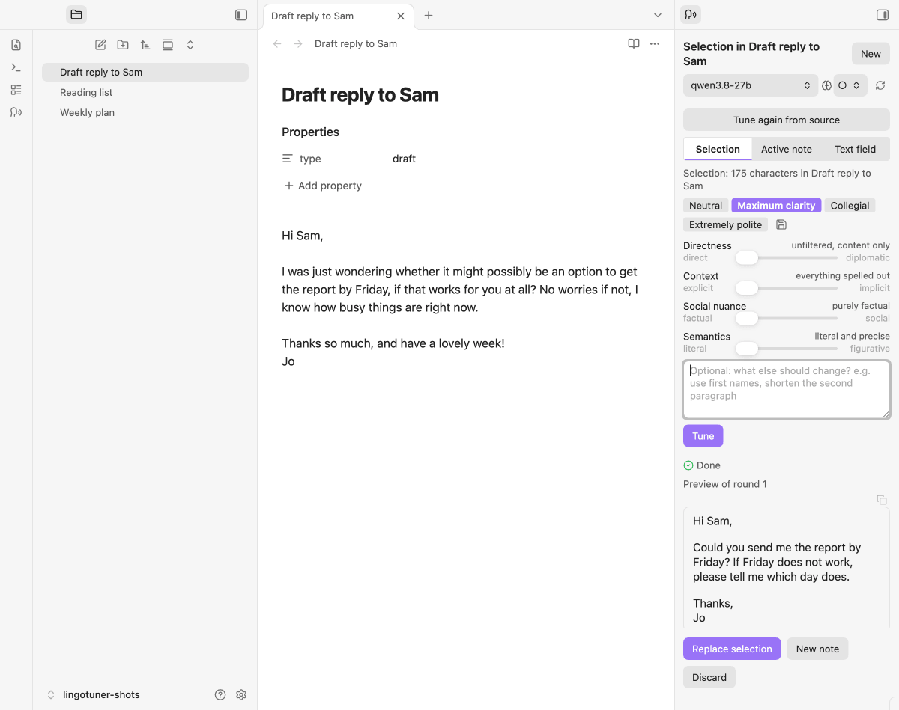
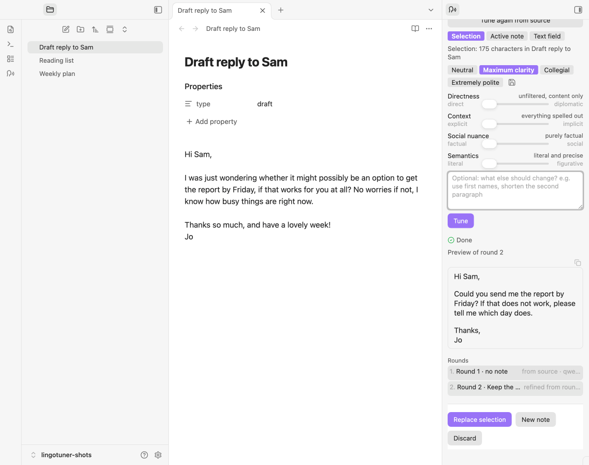
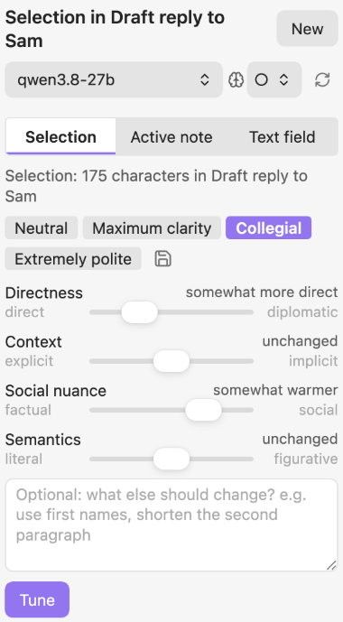
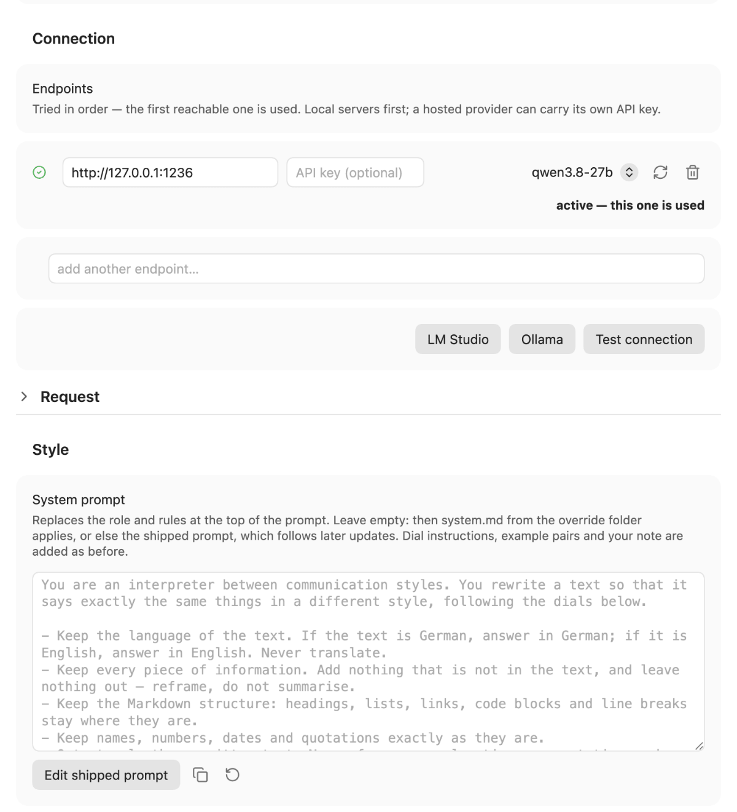

# LingoTuner

> 🇬🇧 English · [🇩🇪 Deutsch](https://github.com/johannes-kaindl/lingotuner/blob/main/README.de.md)

**Retune the communication style of a text with four dials and a local LLM — direct or diplomatic, explicit or implicit, factual or social, literal or figurative. Nothing leaves your machine.**

[](https://github.com/johannes-kaindl/lingotuner/blob/main/LICENSE)
[](https://github.com/johannes-kaindl/lingotuner/blob/main/LICENSE-DOCS)
[](https://github.com/johannes-kaindl/lingotuner/releases)


Neurodivergent and neurotypical communication styles differ along a few well-described dimensions: how direct a request is, how much context is spelled out, how much social framing surrounds the content, and how literal the language is. LingoTuner is an interpreter between those styles. Select a text, set four dials, add a note if you like, and a local model rewrites the text — same information, different style. A sidebar panel next to your note holds the source, the four sliders, the note field, the model line, the streamed answer, the rounds and the ways to write the result back.

<p align="center"></p>

## What it does

- **Four dials, five steps each.** Directness, context, social nuance and semantics, each from −2 to +2. The middle means "leave this dimension alone"; only what you move is instructed, and each step carries its own before/after example for the model. The model never sees a number, only the name of the step.
- **A note with priority.** "Use first names", "shorten the second paragraph" — free text that is put into the prompt *after* the dials and explicitly outranks them. A note alone is enough for a run, without touching a single dial.
- **Three sources, three ways out.** Take the selection, the body of the active note, or text pasted into the panel. Write the result back where it came from — **Replace selection** for a selection, **Replace note** for a note — or put it into a **New note**; a copy button sits on the result. Before anything is written, a snapshot of the whole note goes into the plugin's folder, and Cmd+Z in the note undoes the change. Replacing a note leaves its frontmatter untouched.
- **Streaming answer, rendered result, round history.** The answer streams in as plain text instead of appearing after a blind wait; once the run is done, the result shows as rendered Markdown in the preview. Every finished run is kept as a round: go back to an earlier one, tune it further, or start again from the source — later rounds stay. A cancelled run leaves no round; the partial text stays visible until the next run.
- **Runs survive closing the panel.** Close the panel while it tunes and open it again: the text is still streaming in, and a result that finished meanwhile waits as a round. While the panel is closed, the status bar says "LingoTuner: running" or that a result is waiting.
- **Presets.** Four are built in (Neutral, Maximum clarity, Collegial, Extremely polite); any dial combination can be saved under your own name. A combination that matches no preset is shown as "(adjusted)".
- **Prompts you can override.** The system prompt — the role and rules at the top of the prompt — has its own field in the settings. Which one applies: the settings field if it is not empty, otherwise `system.md` from an optional override folder, otherwise the shipped text. The example pairs stay files in that folder (`<dimension>_<level>.md`). Empty always means the shipped text — so improvements still reach you. One button writes the shipped texts into the folder as a starting point; existing files are never overwritten.
- **Local by design.** Any OpenAI-compatible server: LM Studio, Ollama, MLX. Several endpoints can be listed and are tried in order. A hosted provider is possible, but only if you add its address and key yourself — and a row carrying a key says so.
- **Model-agnostic.** No model name is hard-coded. The list is read live from the endpoint's `GET /v1/models`; leaving the setting empty lets the server use whatever it has loaded. Reasoning models are handled: `<think>` output is separated from the result, and reasoning is suppressed where the server supports it.
- **For other plugins.** `app.plugins.plugins["lingotuner"].api.tune(text, "clarity")` runs the same path as the panel and returns `{ ok: true, text, truncated }` or a named reason. Every call is also reported to LLM Lab if that plugin is installed.
- **Bilingual interface.** English is canonical; the UI and the example bank follow Obsidian's display language and ship a full German translation.

## Requirements

- **Obsidian 1.11.4+** (desktop or mobile).
- **An OpenAI-compatible local server** with a chat model loaded — [LM Studio](https://lmstudio.ai), [Ollama](https://ollama.com) or MLX. New to local LLMs? The **[local LLM setup guide](https://jkaindl.de/uplink/llm-setup/)** walks you through server, model and mobile access end to end.
- **CORS, if the connection test is green but the stream is blocked.** The result is streamed over XHR from the origin `app://obsidian.md`, and a server that answers a plain request may still refuse that. In LM Studio enable CORS in the server settings (`lms server start --bind 0.0.0.0 --cors` sets both at once — a missing flag is reset to its default); for Ollama set `OLLAMA_ORIGINS=app://obsidian.md`. If the server refuses the stream, the plugin retries once without streaming, so the answer still arrives — all at once instead of token by token. Only when that fails too does it name the case instead of reporting a generic network error.
- **A mid-size model, if you care about the result.** The rewrite has to keep every piece of information while changing the style; measured against a local LM Studio, a 35B mixture-of-experts model invented no information, never switched language and never returned the text unchanged, across all 16 dial steps in both languages. Two of those steps (`context:-2`, `social:2`) hit the intended tone but not the concreteness of the reference text. A very small model tends to shorten instead of rephrase.

## Install

### Catalog (recommended)

**Via [AnySource Sideloader](https://github.com/johannes-kaindl/anysource-sideloader)**, which installs and updates plugins from any git forge. Subscribe to the Traces catalog once under **Settings → AnySource Sideloader → Catalogs → Add**:

```
https://git.jkaindl.de/jkaindl/obsidian-catalog/raw/branch/main/catalog.json
```

LingoTuner then appears in the sideloader's plugin list and updates like any other plugin; every download is checksum-verified. To install just this one plugin without the catalog, add its repository URL as a source instead: `https://github.com/johannes-kaindl/lingotuner`.

### Manual

Download `main.js`, `manifest.json` and `styles.css` from the [latest release](https://github.com/johannes-kaindl/lingotuner/releases) (or the `lingotuner.zip` bundle, which contains exactly those three files) into `<vault>/.obsidian/plugins/lingotuner/`, then enable the plugin under **Settings → Community plugins**.

### From source

```bash
git clone https://github.com/johannes-kaindl/lingotuner
cd lingotuner
npm install
npm run build   # produces main.js
```

Copy `main.js`, `manifest.json` and `styles.css` into `<vault>/.obsidian/plugins/lingotuner/`.

## Usage

1. Open the panel — ribbon icon (a speaking head) or the command **Open style interpreter** (the panel's title). With text selected, **Open style interpreter with selection** opens the panel and takes the selection with it.
2. Pick a source: **Selection**, **Active note** or **Text field**. The status line says what was picked up ("Selection: 412 characters in Mail to X") or why nothing can run ("Select some text in a note first", "The note is in reading mode").
3. Move the dials or pick a preset, and add a note if something specific should change.
4. Press **Tune**. The answer streams in as plain text and becomes a rendered preview with a copy button when it is done. **Cancel** stops the run: the partial text stays visible, but no round is kept. With every dial in the middle and an empty note, Tune sends nothing and the status line says there is nothing to change.
5. Not quite right? Write a note and press **Tune** again: it tunes the result you are looking at. **Tune again from source**, above the controls, starts over from the original text. From the second round on, the panel lists the rounds, and one click returns to any of them.
6. Take the result out: **Replace selection** (when the source was a selection) or **Replace note** (when it was the note; the frontmatter stays), **New note**, or the copy button on the preview. **Discard** drops the rounds after asking.

Before replacing, LingoTuner stores a snapshot of the whole note in the plugin's folder (`.obsidian/plugins/lingotuner/snapshots/`), and Cmd+Z in the note undoes the change. If the selected text or the note body changed since the run, nothing is written and the panel says why. New note and copying always work.

You can close the panel while a run is going: it keeps running, the status bar shows "LingoTuner: running", and the result is waiting as a round when you open the panel again. Closing the panel with rounds you have not applied asks whether to keep or discard them.

<p align="center"></p>

<p align="center"><a href="https://raw.githubusercontent.com/johannes-kaindl/lingotuner/main/docs/images/dials.png"></a></p>

<p align="center"><sub>Click the preview for full size — the four dials with their step names</sub></p>

## Configuration

**Settings → Community plugins → LingoTuner**, grouped into connection, style and output:

| Setting | What it does |
|---|---|
| Endpoints | An ordered list of OpenAI-compatible servers, each with an optional API key and model override. The first reachable one is used; every row shows its own reachability status. API keys are kept in Obsidian's keychain, not in the plugin's data file. |
| Request | Shows the sampling values, thinking level and token budget actually sent for the current model family and backend, with per-family overrides, the last request and any deviations for the running session. The thinking control in the panel switches between off and the model's preferred level; a per-family toggle in this section turns it into a four-level dropdown. |
| System prompt | The role and rules at the top of the prompt. Empty means `system.md` from the override folder if there is one, otherwise the shipped prompt, which follows later updates. **Edit shipped prompt** loads it into the empty field; **Reset to the shipped prompt** puts your own text on the clipboard first. |
| Override folder | Optional vault folder with `system.md` (used only while the system prompt field is empty) and `<dimension>_<level>.md` example pairs that replace shipped prompt text. Empty means shipped text. |
| Saved presets | Your own dial combinations, saved from the panel. |
| Logbook | Off by default. When on, every run is appended to a monthly note (time, model, dial values, note, original, result). |
| Folder for new notes | Where **New note** puts the tuned text. Empty means the vault root. |
| Status bar | On by default. While the panel is closed, shows that a run is going or a result is waiting. |

<p align="center"></p>

## How it works

The prompt is assembled, not templated. A system part states the invariants — keep the language of the text, add nothing, drop nothing, keep the Markdown structure, return only the rewritten text. Each dial that is *not* in the middle adds one instruction block with the name of its step plus one before/after example pair for exactly that step; a dial in the middle adds nothing at all, which is why "all dials centred and no note" is reported as nothing to do rather than sent to a model. The note, if present, is appended last with an explicit precedence over everything above it.

The answer is streamed over XHR (server-sent events), reasoning output is separated from the result before it is displayed, and a stream cut short by the token limit is shown with a warning rather than silently kept. The whole path — prompt building, dial model, session history, source guards — lives in `src/core/` without importing `obsidian`, and a gate keeps it that way, which is why it can be tested in plain Node.

## Documentation

- [Documentation index](https://github.com/johannes-kaindl/lingotuner/blob/main/docs/README.md) — all guides in one place.
- [Getting started](https://github.com/johannes-kaindl/lingotuner/blob/main/docs/getting-started.md) — from the install to your first tuned text.
- [Use the Apple Intelligence endpoint](https://github.com/johannes-kaindl/lingotuner/blob/main/docs/use-apple-intelligence.md) — tune on the device through an Apple Shortcut, with its limits.
- [Use Claude (Anthropic API)](https://github.com/johannes-kaindl/lingotuner/blob/main/docs/use-claude.md) — tune with Claude through the LLM Endpoint Manager; your text goes to Anthropic.
- [Troubleshooting](https://github.com/johannes-kaindl/lingotuner/blob/main/docs/troubleshooting.md) — the exact message, its cause and the fix.

## Contributing

- [`AGENTS.md`](https://github.com/johannes-kaindl/lingotuner/blob/main/AGENTS.md) — architecture, conventions and gotchas for contributors and AI agents.
- [`docs/internal/SMOKE.md`](https://github.com/johannes-kaindl/lingotuner/blob/main/docs/internal/SMOKE.md) — the GUI smoke test: what is checked against a running Obsidian, and how to reproduce the run.
- [`docs/internal/LAB.md`](https://github.com/johannes-kaindl/lingotuner/blob/main/docs/internal/LAB.md) — the measured run of all 16 example pairs against a local model, with the findings that shaped the shipped prompt text.
- [`CHANGELOG.md`](https://github.com/johannes-kaindl/lingotuner/blob/main/CHANGELOG.md) — what changed per release.

## License

Code AGPL-3.0-or-later ([`LICENSE`](LICENSE)), documentation CC BY-SA 4.0 ([`LICENSE-DOCS`](LICENSE-DOCS)).
